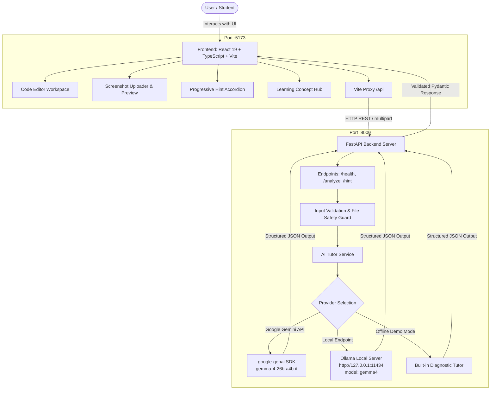

# CodeClarity AI 🚀 — Gemma 4-Powered AI Coding Tutor

[](LICENSE)
[](https://www.python.org/)
[](https://react.dev/)
[](https://ai.google.dev/gemma/docs/core/gemma_on_gemini_api)
[](http://127.0.0.1:11434)

> **Hacktoberfest Challenge — Project 1 MVP**  
> An empathetic, pedagogical AI coding tutor designed to help beginner and intermediate programmers understand, debug, and learn C++ and Python code instead of blindly copying AI-generated solutions.

---

## 1. Product Vision

Beginner programmers often encounter cryptic compiler errors (`Segmentation fault (core dumped)`, `IndexError: list index out of range`, `TypeError: unsupported operand type(s)`) and turn to generative AI chatbots. Existing chatbots often dump raw corrected code without explaining *why* the bug occurred, stunting conceptual learning.

**CodeClarity AI** changes that paradigm:
1. **Pedagogical, Progressive Hints**: Nudges students in the right direction without spoiling answers immediately (Level 1: Gentle Nudge → Level 2: Cause & Mechanism → Level 3: Verified Solution).
2. **Structured Debugging Reports**: Breakdowns with root-cause explanations, pinpointed code locations, and verified test cases.
3. **Computer Science Concept Hub**: Explains fundamental CS concepts (Zero-Based Indexing, Pointer Safety, List Mutability) with minimal code examples.
4. **Multimodal Screenshot Support**: Accepts IDE or terminal error screenshots directly, extracting code and compiler logs.
5. **Safe Static Analysis**: User-submitted code is analyzed strictly as static text and is **never** executed on host servers.

---

## 2. System Architecture



---

## 3. Technology Stack

- **Frontend**: React 19, TypeScript, Vite, Vanilla CSS Design System with dark navy & violet aesthetics, Lucide React icons.
- **Backend**: Python 3.10+ with FastAPI, Pydantic v2, Uvicorn, Python-Multipart.
- **AI Integration**:
  - **Google Gemini API**: Uses the official Google Gen AI Python SDK (`google-genai`) with model identifier `gemma-4-26b-a4b-it`.
  - **Local Ollama Support**: Seamless local fallback to Ollama running `gemma4` at `http://127.0.0.1:11434/api/chat`.
  - **Offline Educational Fallback**: High-fidelity built-in tutor ensuring the app is immediately demonstrable without internet access or an API key.
- **Testing**: Pytest with automated API validation and schema assertion tests.

---

## 4. Gemma 4 Integration Verification

### Model Identifier Verification
Per Google Developer Documentation ([Gemma on Gemini API](https://ai.google.dev/gemma/docs/core/gemma_on_gemini_api)):
- The official model identifier for Gemma 4 via the Gemini API is:
  ```text
  gemma-4-26b-a4b-it
  ```
- Active configuration parameters: Instruction-tuned (`-it`), 26B total parameter Mixture-of-Experts architecture with 4B active parameters (`a4b`), supporting multimodal text/image understanding and internal thinking reasoning.
- Configurable environment variable: `GEMMA_MODEL_NAME=gemma-4-26b-a4b-it` in `.env`.
- For local Ollama users, the model identifier is `OLLAMA_MODEL_NAME=gemma4`.

### Untrusted Input & Safety Guardrails
- **No Arbitrary Code Execution**: CodeClarity AI performs 100% static code comprehension. No user-submitted scripts are executed or compiled on the server.
- **Strict Secret Isolation**: The `GEMINI_API_KEY` is loaded exclusively on the backend from `.env`. The key is never exposed to the frontend, never returned in API payloads, and never logged.
- **Image Safety**: Screenshot uploads are limited to PNG, JPG, and JPEG with an enforced maximum file size of 5MB.

---

## 5. Main Features

| Feature | Description |
|---|---|
| **Code Workspace** | Interactive code editor supporting **C++** and **Python** with line counters, syntax formatting, and problem description input. |
| **1-Click Sample Snippets** | Preloaded realistic bugs (Python `IndexError`, `TypeError`, `IndentationError`, and C++ `Vector Out of Bounds`, `Null Pointer Dereference`, `Missing Semicolon`). |
| **Screenshot Analysis** | Drag-and-drop terminal or IDE screenshots. Gemma 4 inspects visible compiler messages and code. |
| **Progressive Hints** | Three tiers of pedagogical assistance: Gentle nudge, Detailed mechanism & cause, and Solution guidance. |
| **Structured Report** | Problem summary, error category badge, beginner-friendly explanation, identified code location, corrected code with 1-click Copy, why it works, and 3 verified test cases. |
| **Learning Mode** | Concept hub explaining foundational CS topics (Zero-based indexing, pointer safety, mutability) with minimal code examples. |

---

## 6. Installation & Setup

### Prerequisites
- Python 3.10 or later
- Node.js v18+ and npm

### Clone Repository
```bash
git clone https://github.com/your-username/codeclarity-ai.git
cd codeclarity-ai
```

---

### Step 1: Backend Setup

#### Windows (PowerShell)
```powershell
# Create and activate virtual environment (optional)
python -m venv venv
.\venv\Scripts\Activate.ps1

# Install backend dependencies
pip install -r backend/requirements.txt
```

#### macOS / Linux
```bash
# Create and activate virtual environment (optional)
python3 -m venv venv
source venv/bin/activate

# Install backend dependencies
pip install -r backend/requirements.txt
```

---

### Step 2: Environment Configuration

Copy `.env.example` to `.env`:
```bash
cp .env.example .env
```

Edit `.env` to configure your preferred engine:
```ini
# Google Gemini API Key (obtain free at https://aistudio.google.com/apikey)
GEMINI_API_KEY=your_gemini_api_key_here

# Gemma 4 Model Identifier
GEMMA_MODEL_NAME=gemma-4-26b-a4b-it

# Provider Mode: "auto", "google", or "ollama"
AI_PROVIDER=auto

# Optional Local Ollama Settings
OLLAMA_BASE_URL=http://127.0.0.1:11434
OLLAMA_MODEL_NAME=gemma4
```

> **Note**: If `GEMINI_API_KEY` is not provided and Ollama is not running, CodeClarity AI automatically engages its built-in pedagogical diagnostic engine so you can test all features and workflows immediately.

---

### Step 3: Frontend Setup

```bash
cd frontend
npm install
cd ..
```

---

## 7. Running the Application

### Option A: Running with Two Terminals

**Terminal 1 (Backend Server):**
```bash
# Windows / macOS / Linux
python backend/run_backend.py
```
*Backend starts on `http://127.0.0.1:8000` (API documentation available at `http://127.0.0.1:8000/docs`).*

**Terminal 2 (Frontend Client):**
```bash
cd frontend
npm run dev
```
*Frontend starts on `http://127.0.0.1:5173` with automated proxy to the backend API.*

Open **`http://127.0.0.1:5173`** in your browser.

---

## 8. Running the Backend Test Suite

To run the automated backend test suite:
```bash
python -m pytest backend/tests/test_api.py -v
```

All 7 test suites validate:
- `GET /api/health` configuration and secrecy protection
- Input validation (empty code handling, unsupported image types)
- Python structured analysis schema conformity
- C++ analysis schema conformity
- Progressive hint generation across all 3 levels
- Input error handling

---

## 9. Sample Demo Workflow

1. Open `http://127.0.0.1:5173`.
2. Notice the pre-loaded **Python: List Index Out of Range** code.
3. Click the prominent **Analyze Code** button.
4. Observe the structured debugging report appearing in under 2 seconds:
   - **Diagnosis**: Explains why `range(len(scores) + 1)` exceeds valid list boundaries.
   - **Progressive Hints**: Read the gentle nudge. Click **Unlock Level 2** to view the underlying indexing mechanism. Click **Reveal Solution** to see the direct fix.
   - **Corrected Code**: Click **Copy Code** to copy the clean solution with clipboard confirmation.
   - **Test Cases**: Inspect 3 suggested test cases covering standard inputs, empty lists, and boundary conditions.
5. In the Quick Samples bar, click **C++: Vector Out of Bounds** or **C++: Null Pointer Dereference** to inspect C++ debugging.
6. Click **Learn Concepts** in the left sidebar to explore foundational CS principles (Zero-Based Indexing, Pointer Safety, List Mutability).
7. Click **About & Docs** to review the architecture and Gemma 4 model card specifications.

---

## 10. API Specification

### `GET /api/health`
Returns system status without revealing private secrets.
```json
{
  "status": "healthy",
  "provider": "google",
  "model": "gemma-4-26b-a4b-it",
  "api_key_configured": true,
  "ollama_url": "http://127.0.0.1:11434",
  "ollama_model": "gemma4",
  "supported_languages": ["python", "cpp"]
}
```

### `POST /api/analyze`
Analyzes code and optional error logs or screenshots. Accepts JSON or `multipart/form-data`.
```json
{
  "summary": "The Python code attempts to access an element at an index that does not exist in the collection.",
  "error_category": "IndexError / Out of Bounds",
  "explanation": "In Python, indexing starts at 0 and goes up to length - 1...",
  "code_location": "Loop index subscript at line 7",
  "suggested_fix": "Change the loop range to range(len(scores)) or use direct iteration.",
  "corrected_code": "scores = [85, 92, 78, 90, 88]\ntotal = sum(scores)\nprint('Average:', total / len(scores))",
  "why_it_works": "Direct iteration avoids manual index arithmetic and bounds overflow.",
  "test_cases": [
    {"description": "Standard list of scores", "input": "[85, 90]", "expected_output": "Average: 87.5"},
    {"description": "Empty list boundary", "input": "[]", "expected_output": "Safe handling without crash"},
    {"description": "Single element", "input": "[100]", "expected_output": "Average: 100.0"}
  ],
  "learning_concept": {
    "concept_name": "Zero-Based Indexing & Memory Boundaries",
    "explanation": "Computers start counting sequences from offset 0...",
    "quick_example": "items = ['a', 'b']; print(items[0])"
  },
  "hints": {
    "gentle": "Take a close look at how many items exist versus the loop bound.",
    "detailed": "A list of N items has valid indices 0 to N-1. Check your range upper bound!",
    "solution": "Change range(len(scores) + 1) to range(len(scores))."
  },
  "model_used": "gemma-4-26b-a4b-it",
  "provider_used": "google"
}
```

### `POST /api/hint`
Retrieves a specific progressive hint level (`gentle`, `detailed`, or `solution`).
```json
{
  "level": "gentle",
  "hint": "Take a close look at how many items exist versus the loop bound.",
  "model_used": "gemma-4-26b-a4b-it"
}
```

---

## 11. Project Limitations

1. **Static Analysis Only**: In adherence to safety guidelines, user-submitted code is not executed in runtime sandboxes. Dynamic runtime analysis (e.g., executing code under GDB or Valgrind) is reserved for future iterations.
2. **Offline Fallback**: When running without internet access or without a Gemini API key / Ollama instance, the built-in diagnostic tutor provides immediate feedback for typical error patterns.
3. **Model Availability**: The application defaults to Google's official `gemma-4-26b-a4b-it`. If custom fine-tuned weights or alternative endpoints are required, update `GEMMA_MODEL_NAME` in `.env`.

---

## 12. License

This project is licensed under the [MIT License](LICENSE).
